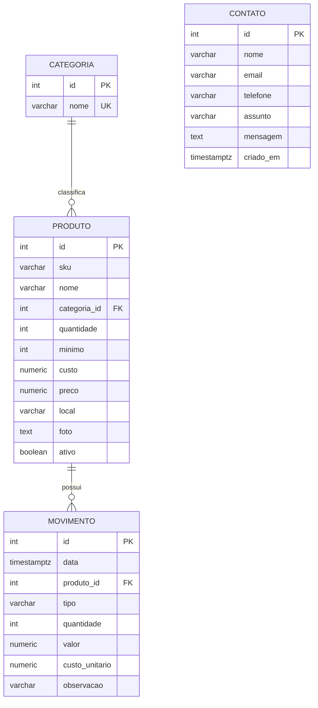

# DER e Modelo Lógico — TecnoCaixa

## Diagrama Entidade-Relacionamento

Cole o bloco abaixo em https://mermaid.live para gerar a imagem (PNG/SVG) para o relatório.



`CONTATO` não se relaciona com as demais tabelas: guarda as mensagens do
formulário do site, que são independentes do estoque.

## Modelo Lógico

```
categoria (id PK, nome UNIQUE NOT NULL)

produto   (id PK, sku NOT NULL, nome NOT NULL,
           categoria_id FK -> categoria.id NOT NULL,
           quantidade, minimo, custo, preco, local, foto, ativo)

movimento (id PK, data, produto_id FK -> produto.id NOT NULL,
           tipo, quantidade, valor, custo_unitario, observacao)

contato   (id PK, nome, email, telefone, assunto, mensagem, criado_em)
```

## Relacionamentos

| Relação | Cardinalidade | Chave estrangeira | Regra |
|---|---|---|---|
| categoria → produto | 1 : N | `produto.categoria_id` | Todo produto pertence a uma categoria |
| produto → movimento | 1 : N | `movimento.produto_id` | `ON DELETE RESTRICT`: produto com histórico não é apagado de verdade |

## Decisões de modelagem (para explicar no seminário)

- **Normalização (3FN):** a categoria saiu de `produto` (texto repetido) e virou a tabela `categoria`. O nome do produto não é mais copiado em `movimento`: o histórico acessa o nome pela chave estrangeira.
- **Exclusão lógica:** excluir um produto marca `ativo = FALSE`. Assim o histórico de movimentações continua íntegro, sem FK quebrada.
- **`custo_unitario` em `movimento`:** é uma cópia proposital do custo no momento da operação. Se o custo do produto mudar depois, o lucro das vendas antigas continua correto.
- **SKU único entre ativos:** índice único parcial (`WHERE ativo`), que libera o SKU de um produto excluído.
- **Restrições `CHECK`:** quantidade, custo e preço não negativos, quantidade de movimento positiva e `tipo` limitado a entrada, venda ou saida.