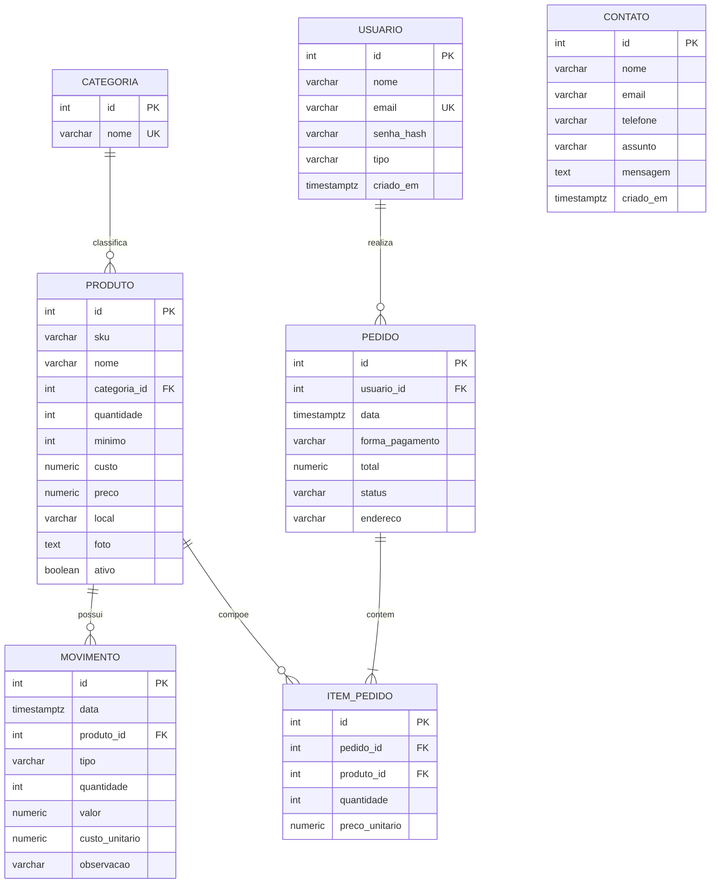

# DER e Modelo Lógico — TecnoCaixa

## Diagrama Entidade-Relacionamento

Cole o bloco abaixo em https://mermaid.live para gerar a imagem (PNG/SVG) para o relatório.



`CONTATO` não se relaciona com as demais tabelas: guarda as mensagens do
formulário do site, que são independentes do estoque.

## Modelo Lógico

```
categoria   (id PK, nome UNIQUE NOT NULL)

produto     (id PK, sku NOT NULL, nome NOT NULL,
             categoria_id FK -> categoria.id NOT NULL,
             quantidade, minimo, custo, preco, local, foto, ativo)

movimento   (id PK, data, produto_id FK -> produto.id NOT NULL,
             tipo, quantidade, valor, custo_unitario, observacao)

usuario     (id PK, nome, email UNIQUE NOT NULL, senha_hash, tipo, criado_em)

pedido      (id PK, usuario_id FK -> usuario.id NOT NULL,
             data, forma_pagamento, total, status, endereco)

item_pedido (id PK, pedido_id FK -> pedido.id NOT NULL,
             produto_id FK -> produto.id NOT NULL,
             quantidade, preco_unitario)

contato     (id PK, nome, email, telefone, assunto, mensagem, criado_em)
```

## Relacionamentos

| Relação | Cardinalidade | Chave estrangeira | Regra |
|---|---|---|---|
| categoria → produto | 1 : N | `produto.categoria_id` | Todo produto pertence a uma categoria |
| produto → movimento | 1 : N | `movimento.produto_id` | `ON DELETE RESTRICT`: produto com histórico não é apagado de verdade |
| usuario → pedido | 1 : N | `pedido.usuario_id` | Todo pedido pertence a um usuário cadastrado |
| pedido → item_pedido | 1 : N | `item_pedido.pedido_id` | `ON DELETE CASCADE`: os itens pertencem ao pedido |
| produto → item_pedido | 1 : N | `item_pedido.produto_id` | `ON DELETE RESTRICT`: preserva o histórico dos produtos comprados |

## Decisões de modelagem (para explicar no seminário)

- **Normalização (3FN):** a categoria saiu de `produto` (texto repetido) e virou a tabela `categoria`. O nome do produto não é mais copiado em `movimento`: o histórico acessa o nome pela chave estrangeira.
- **Exclusão lógica:** excluir um produto marca `ativo = FALSE`. Assim o histórico de movimentações continua íntegro, sem FK quebrada.
- **`custo_unitario` em `movimento`:** é uma cópia proposital do custo no momento da operação. Se o custo do produto mudar depois, o lucro das vendas antigas continua correto.
- **SKU único entre ativos:** índice único parcial (`WHERE ativo`), que libera o SKU de um produto excluído.
- **Restrições `CHECK`:** quantidade, custo e preço não negativos, quantidade de movimento positiva e `tipo` limitado a entrada, venda ou saida.